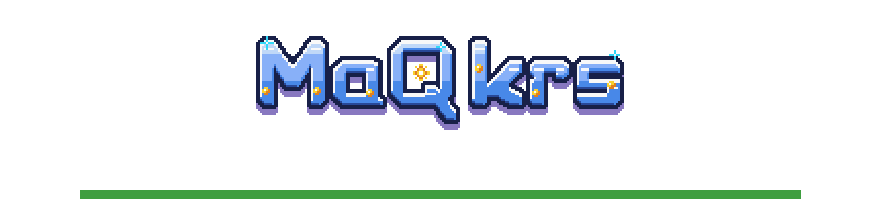
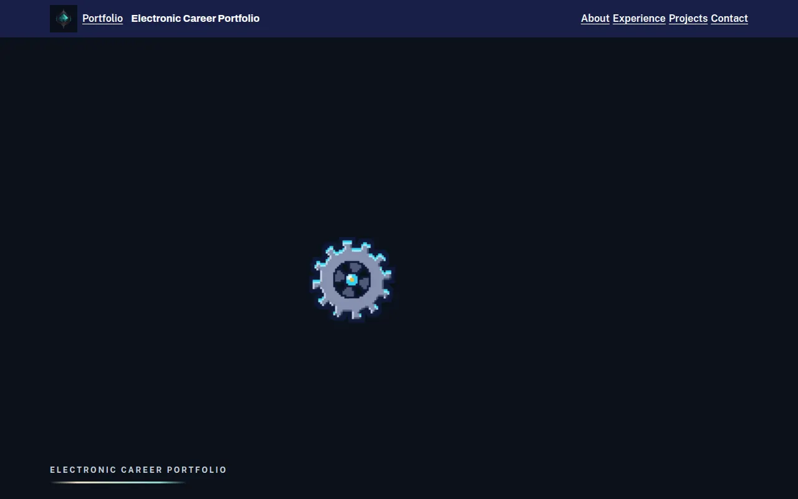
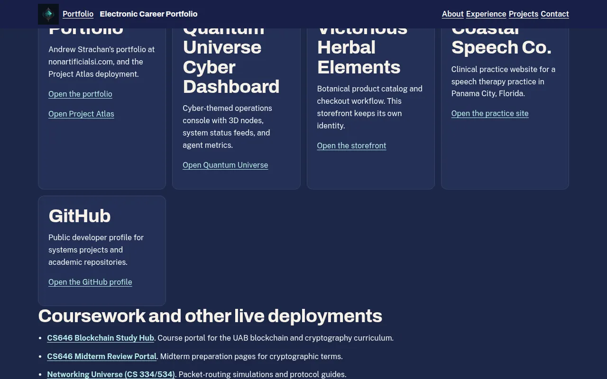
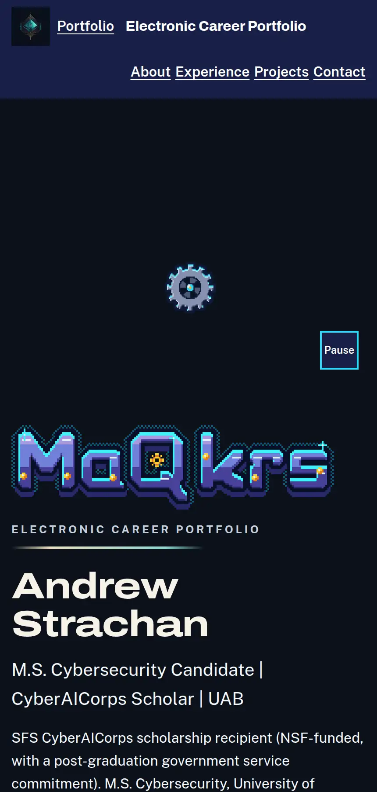
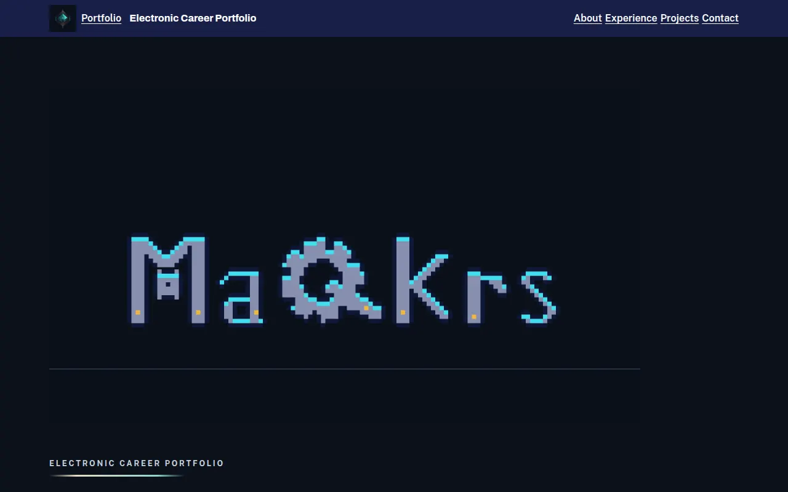

<p align="center">
  <picture>
    <source media="(prefers-color-scheme: dark)" srcset="docs/brand/banner-dark.png">
    
  </picture>
</p>

# Electronic Career Portfolio

A public career site for Andrew Strachan, an M.S. Cybersecurity candidate at the University of Alabama at Birmingham and an SFS CyberAICorps scholarship recipient.

**Status:** Pre-release: demo build. The pages are built and tested locally. Firebase Hosting for career.nonartificialsi.com is not deployed from this repo yet.

Not deployed · Part of [Andrew Strachan's portfolio](https://www.nonartificialsi.com)

## What it does today

- Presents four chapters: about, experience, projects, and contact, readable with JavaScript off.
- Links every live deployment from the approved project list, including CS646 Sanctum, MaQkrs AI Tutor, AdaptiveSchool, MaQkrs Command Center, and the coursework hubs.
- Plays the MaQkrs gear-title intro once, muted, with a Skip control. Reduced motion, Save-Data, and a frame probe under 50 fps show the still instead.
- Uses the self-hosted MaQkrs brand kit (wordmark, circuit-M mark, portrait, cubebot badge, and tokens).

## Planned

- Firebase Hosting on site `maqkrs-career` at https://career.nonartificialsi.com [planned]
- Hub registry row in maqkrs-dashboard [planned]

## Screens

| Desktop intro | Projects chapter |
|---|---|
|  |  |

| 430 px wide | Reduced motion |
|---|---|
|  |  |

Captured from the local demo build. No real user data, keys, emails, or tokens appear in them. The address strachan@uab.edu is the public contact address from the fact sheet and is not shown in these frames.

## How it's built

- Static HTML and CSS. A small module script loads GSAP 3 and ScrollTrigger only after a frame probe, and only animates transform, opacity, and clip-path.
- Firebase Hosting config targets site `maqkrs-career` in project `maqkrs-command-center-i`. There is no Firestore database and no Cloud Functions.
- Brand files are copied into the repo. Pages do not request the brand kit host at runtime.
- No AI features in this build.

## Run it locally

From the repository root:

```sh
npm install
npm run build
npm run dev
```

`npm run dev` builds `dist/` and serves it at http://127.0.0.1:8080/. This site does not read environment variables. `.env.example` is only a reminder not to commit secrets.

## Tests and checks

```sh
npm test
npm run build
gitleaks dir . --redact
```

`npm test` builds first, then runs the claims gate, the emoji gate, hosting-target checks, and a Playwright plus axe-core pass of the landing page, the sources page, and the 404 page.

## Security

No secrets are committed. Configuration for a future deploy is the Firebase project and hosting target in `.firebaserc` and `firebase.json`, not an API key. Report a problem to strachan@uab.edu.

## Credits

Author: Andrew Strachan.

## License

All rights reserved. Source shared for review.
